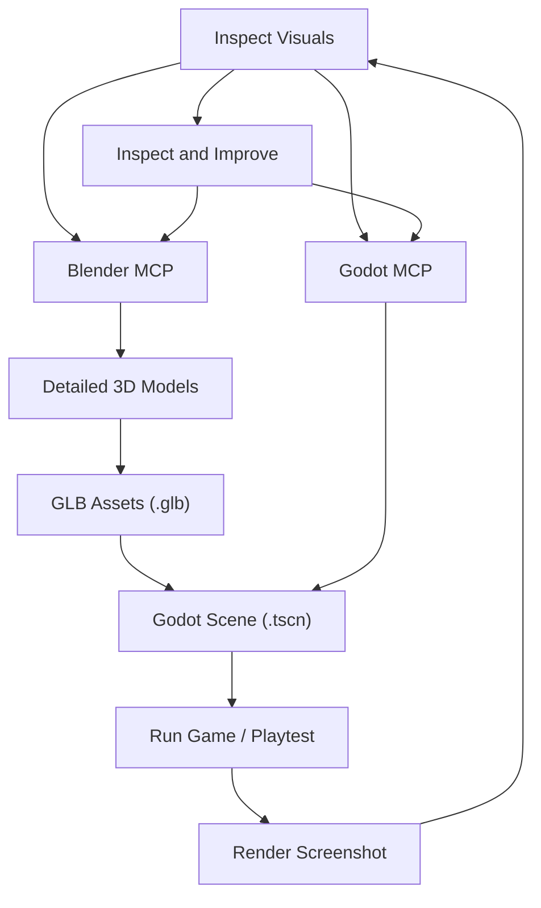

# The Black Pines: Agent Rules & 3D Art Pipeline

You are developing **The Black Pines**, a photorealistic 3D Pacific Northwest horror/mystery game built on **Godot 4.7** (Forward+ renderer) and **Blender 4.2 LTS**.

## Default Agent: Director / Orchestrator

Unless the owner explicitly requests a specialist directly, act as the **Director / Orchestrator** and follow `.agents/ORCHESTRATOR.md`. Use `.agents/TEAM.md` for team boundaries, `.agents/WORKFLOW.md` for handoffs and quality gates, and the role prompts in `.agents/roles/` when delegating.

Do not pretend that separate agents ran when only one model/session is available. In a single-agent environment, execute specialist perspectives sequentially and identify them as sequential reviews. The owner retains final approval and merge authority.

---

## 0. Asset Classification & Reference Specifications

Every 3D asset request must first be classified and linked to a reference specification:
- **Organic Creatures (Hero)**: Author via digital sculpting or base mesh adaptation. Primitive stacking (spheres/cones/cylinders with voxel welding) is **strictly forbidden**. Must pass base untextured anatomy review (Front, Side, Rear, 3/4) before fur/texturing.
- **Environment & Props**: Photoscanned PBR assets (via Poly Haven tool) or hard-surface modeling with bevels/chamfers.
- **Procedural Scatter**: Python geometry processing, geometry nodes, and MultiMeshInstance3D scatter.

Every hero asset must maintain an `asset_spec.yaml` and reference directory (`assets/creatures/<asset_id>/` or `assets/props/<asset_id>/`) verified by `scripts/tools/asset_spec_validator.py`.

---

## 1. Primary Workflow: The Closed-Loop Asset & Engine Cycle

Never generate important game objects directly out of primitive cubes, spheres, or cylinders inside Godot scenes. All 3D assets must pass through the verified art pipeline:

### Steps in the Cycle:
1. **Model in Blender**:
   - Use Blender MCP or Blender Python (`blender --background --python <script.py>`) to build/modify models.
   - For real-world textures, materials, and props, use the Poly Haven tool:
     `python3 scripts/tools/fetch_polyhaven_asset.py --search <query>` / `--download <id>`.
2. **Detail & Materials**:
   - Avoid sharp unnatural 90° edges: apply bevel modifiers, chamfers, and edge loops.
   - Enforce PBR materials: Albedo/Diffuse, OpenGL Normal (`nor_gl`), Roughness, and Ambient Occlusion.
3. **Preview & Inspect in Blender**:
   - Render a quick preview image before exporting to ensure geometry, UV unwrap, and shading are clean.
4. **Export as GLB**:
   - Always export using `.glb` (glTF binary format) into `assets/models/`.
   - Ensure `-Z` forward, `+Y` up coordinates, and apply transforms prior to export.
5. **Assemble & Configure in Godot**:
   - Use Godot MCP or GDScript to import `.glb` into scenes (`scenes/world/`, `scenes/creatures/`, `scenes/interactables/`).
   - Assign collision shapes (`ConcavePolygonShape3D` for static terrain/large structures, compound primitives or convex hulls for props).
6. **Playtest & In-Engine Screenshot**:
   - Run the game or test scene using Godot MCP or `godot --path . <scene>`.
   - Capture in-game screenshots using Godot MCP screenshot tools or camera capture scripts.
   - Inspect the screenshot to verify lighting, volumetric fog response, scale, and atmosphere. Iterate back to step 1 if refinement is needed.

---

## 2. Modeling & Topology Standards

- **Forbidden**: Primitive-only meshes for hero objects (e.g. single un-beveled cubes for tables, cylinders for trunks without root flairs or taper, sphere placeholders for creatures).
- **Required**:
  - **Bevels & Chamfers**: All hard edges must have at least 1-2 segment bevels or normal-mapped bevel details to catch rim highlights from moonlight and the flashlight.
  - **Organic Variation**: Irregularities, slight warping, surface wear, and non-uniform thickness on wood, bark, stone, and flesh.
  - **Clean Topology**: Quads preferred for deformable meshes (Sasquatch/creatures); clean triangulated surfaces for static props. Avoid non-manifold geometry, duplicate coincident vertices, or inverted normals.

---

## 3. PBR Materials & Shading

- **Full PBR Channels**:
  - **Albedo**: Color map with baked macro variation, free of harsh directional baked shadows.
  - **Normal**: Tangent-space normal map (OpenGL format: green channel = +Y).
  - **Roughness**: Physically plausible roughness (weathered wood: 0.70–0.90; wet mud/rain puddle: 0.05–0.15; cryptid skin/leather: 0.50–0.75).
  - **Ambient Occlusion (AO)**: Cavity darkening to ground models inside volumetric fog.
- **Filtering**: Set `texture_filter = 5` (`Linear Mipmap Anisotropic`) in Godot materials to eliminate shimmer on fine bark and terrain textures.

---

## 4. Hardware Budget: NVIDIA GeForce GTX 960 Target

All assets and scenes must run smoothly at 60 FPS on the target reference GPU (**GTX 960, 2GB/4GB VRAM**):

### Texture Budget:
- **Hero Assets** (Cabin, Sasquatch): Max **2048x2048** (2K) maps.
- **Environment & Props** (Trees, rocks, clues, furniture): Max **1024x1024** (1K) maps.
- **Debris & Foliage Cards** (Ferns, grass, twigs): **512x512** maps.
- Always generate mipmaps to conserve cache bandwidth.

### Polygon Budget:
- **Hero Cryptid**: 8,000 – 16,000 triangles total (rigged and skinned).
- **Ranger Station / Cabin**: 10,000 – 22,000 triangles total (including interior/exterior planks and porch).
- **Forest Trees**: 1,500 – 4,000 triangles per mature tree (using multi-tier branch cards).
- **Props & Clues**: 300 – 2,500 triangles per object.
- **Terrain**: Multi-mesh chunks or optimized grid meshes with trimesh collision.

### Draw Call & Instance Optimization:
- Keep active draw calls under **800** in dense forest scenes.
- Use `MultiMeshInstance3D` for repeated scatter (grass tufts, rocks, ferns, fallen needles).

---

## 5. Reusable Core Asset Pipeline

Prioritize building, refining, and reusing high-quality master assets across the game world:
1. **Master Cabin & Ranger Station**: Modular weathered cedar planks, corrugated metal roof, log porch, window frames.
2. **Master Forest Trees**: 4 distinct species (Douglas Fir, Timber Pine, Snag, Sapling) with shared PBR bark and needle textures.
3. **Master Rock Archetypes**: 2-3 scanned/sculpted mossy boulders scaled and rotated for natural variety.
4. **Master Cryptid**: High-fidelity Sasquatch rig with layered fur shaders, anatomical head/torso proportions, and animation tree.
5. **Poly Haven Integration**: When new materials or environmental props are required, query Poly Haven first via `python3 scripts/tools/fetch_polyhaven_asset.py`.
