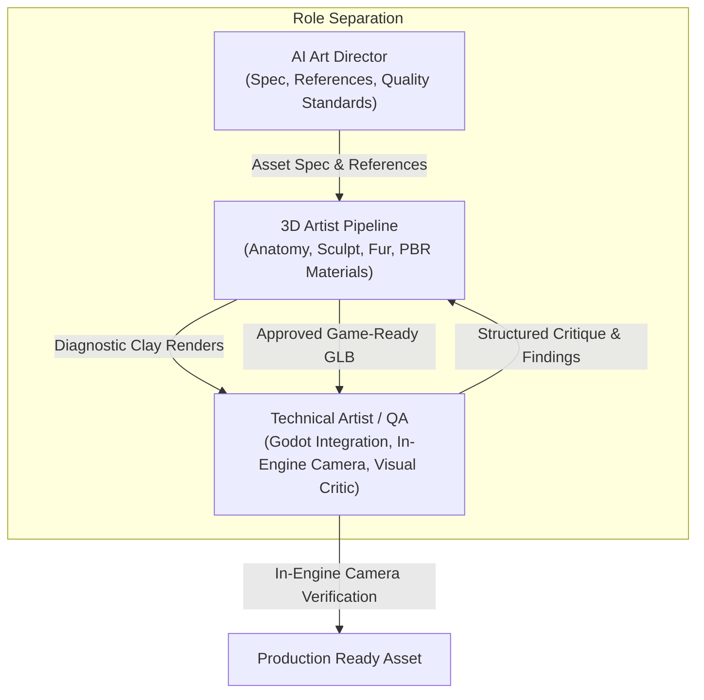
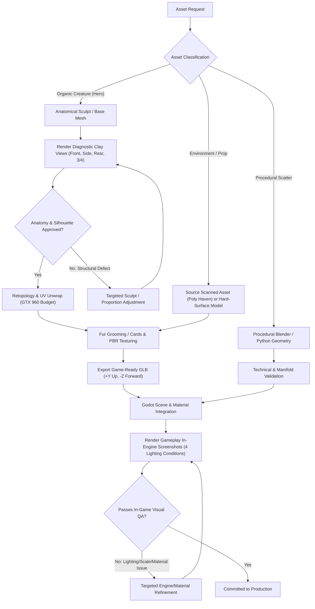

# [P0 Master Issue] Rebuild AI-Assisted Graphics Pipeline for Production-Quality Assets

## 1. Problem Statement & Motivation
Currently, Antigravity, Blender MCP, and Godot MCP can successfully execute Python generation scripts, but the generated 3D assets often lack visual quality and fidelity. The root cause is a **collapse of responsibilities**: a single agent is tasked with interpreting visual concept art, writing low-level Python primitive geometry (cones, cylinders, spheres), remeshing them, and declaring victory when an `.obj` or `.glb` is exported.

A technically valid, manifold mesh is **not** a finished hero asset. In *The Black Pines*, photorealism and grounded Pacific Northwest dread are core pillars. Our AI pipeline must separate roles and enforce strict visual quality gates before any asset reaches the game engine.

The **Classic Bigfoot** (*The Forest Giant*) is the pilot benchmark. If the pipeline cannot produce a convincing, anatomically correct Classic Bigfoot matching our visual reference, it is not ready to generate the rest of the cryptid roster.

---

## 2. Core Operational Principles

1. **Role Separation**:
   - **AI Art Director**: Analyzes visual references, defines anatomy/proportions in an `asset_spec.yaml`, and sets acceptance thresholds.
   - **3D Artist Pipeline**: Executes anatomical sculpts, retopology, UV unwrapping, fur card grooming, and PBR textures. Rejects primitive-stacking for organic heroes.
   - **Technical Artist / QA**: Validates mesh topology, polycount budgets (GTX 960), imports into Godot, tests materials under flashlight/volumetric fog, and renders multi-angle diagnostics for critique.
2. **Reference-Driven Foundation**:
   - Concept art and turnarounds are permanent, versioned assets under `assets/creatures/<id>/references/`, not ephemeral prompt attachments.
3. **Anatomy Before Fur**:
   - No fur, fog, or dark lighting tricks may be applied until the naked base silhouette and anatomical proportions pass multi-angle review.
4. **Structured Feedback Loops**:
   - Renders are evaluated by a vision critic that returns structured, actionable JSON findings (category, severity, issue, remediation) rather than subjective praise.
5. **GTX 960 Hardware Budget Adherence**:
   - Cryptid polycount budget: 8,000 – 16,000 triangles total.
   - Textures: Max 2048x2048 (2K) maps for hero cryptids.
   - Material response: Forward+ Vulkan, 60 FPS locked.

---

## 3. High-Level Pipeline Decision Workflow

---

## 4. Implementation Sub-Issues & Roadmap

| Sub-Issue | Priority | Title | Target Deliverables |
|---|---|---|---|
| [Issue 1](file:///home/m3tal/apps/the-black-pines/docs/issues/001_reference_management_and_specs.md) | **P0** | **Reference Management & Asset Specifications** | Standardized folder structure (`references/`, `source/`, `working/`, `exports/`, `materials/`, `qa/`), `asset_spec.yaml`, and `asset_spec_validator.py`. |
| [Issue 2](file:///home/m3tal/apps/the-black-pines/docs/issues/002_replace_primitive_hero_generation.md) | **P0** | **Replace Primitive-Based Hero Asset Generation** | Deprecate primitive stacking for hero objects; establish request classification (Organic vs Prop vs Procedural) and base anatomy evaluation standards. |
| [Issue 3](file:///home/m3tal/apps/the-black-pines/docs/issues/003_screenshot_visual_qa.md) | **P0** | **Screenshot-Driven Diagnostic Visual QA & Structured Critic** | Automated Blender diagnostic studio (4 neutral views) and structured JSON critique schema (`scripts/tools/visual_critic.py`). |
| [Issue 4](file:///home/m3tal/apps/the-black-pines/docs/issues/004_sculpting_retopology_pipeline.md) | **P1** | **High-Quality Organic Sculpting & Retopology Pipeline** | Anatomic basemesh blockout, digital sculpting/forms, quad-dominant retopology under GTX 960 budget (8k-16k tris for cryptids), and normal baking. |
| [Issue 5](file:///home/m3tal/apps/the-black-pines/docs/issues/005_fur_materials_surface_detail.md) | **P1** | **Fur, Materials, & Surface Detail Pipeline** | Layered fur cards with directional grooming, leathery skin PBR textures (Albedo, OpenGL Normal, Roughness, AO), and eye tapetum lucidum setup. |
| [Issue 6](file:///home/m3tal/apps/the-black-pines/docs/issues/006_godot_integration_validation.md) | **P1** | **Godot Asset Integration & In-Game Camera Validation** | Godot import, skeleton/rig binding, collision hull generation, dynamic flashlight/fog camera screenshot capture (`scripts/tools/capture_gameplay_qa.gd`). |
| [Issue 7](file:///home/m3tal/apps/the-black-pines/docs/issues/007_sequential_orchestration.md) | **P2** | **Sequential Asset Orchestration & Iteration Limits** | Single-agent multi-stage execution (Orchestrator -> Modeler -> Critic -> Integrator) with hard iteration caps (max 3-5 iterations) to prevent runaway token usage. |

---

## 5. Master Acceptance Criteria

- [ ] **End-to-End Benchmark**: The **Classic Bigfoot** asset is authored and verified through this pipeline without primitive cylinder/cone stacking.
- [ ] **Untextured Anatomy Approval**: Multi-angle diagnostic clay renders (front, side, rear, 3/4) confirm sagittal crest, ape brow, broad flat nose, barrel chest, and long arms matching concept art before fur is applied.
- [ ] **Budget Compliance**: Final exported `.glb` is under 16,000 triangles and utilizes 2K max PBR textures.
- [ ] **In-Engine Verification**: In-game captures show authentic integration in volumetric fog and under flashlight beams without shader artifacts.
- [ ] **Repeatability**: The workflow is documented and executable across other cryptids (*Pine Ridge Ghoul / Wendigo*, *Rockhide*, *Bog Stalker*).
