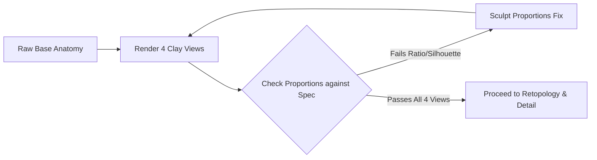

# [P0 · Issue 2] Replace Primitive-Based Hero Asset Generation

## 1. Objective
Abolish procedural primitive-stacking (combining cones, spheres, and cylinders with voxel remeshing) for organic hero creatures. Establish strict triage rules that route asset requests to appropriate 3D modeling workflows based on asset category.

---

## 2. The Core Problem: Why Primitive Stacking Fails Hero Art
In early iterations, scripts like `build_sasquatch_blender.py` constructed anatomy by positioning mathematical primitives:
- Torso: Overlapping UV spheres.
- Cranium & Crest: Ellipsoid with an attached cone.
- Limbs: Tapered cylinders.
- Voxel remeshing + smoothing was then applied to fuse these volumes.

While this produces a watertight manifold mesh that compiles cleanly in Godot, it creates lumpy, balloon-like, unnatural anatomy lacking genuine skeletal landmarks, muscle origin/insertion lines, and expressive facial structure.

---

## 3. Mandatory Asset Classification & Routing

Every asset request must be classified into one of three categories before opening Blender:

| Category | Typical Assets | Authorized Creation Method | Prohibited Method |
|---|---|---|---|
| **Organic Creature (Hero)** | Sasquatch, Wendigo, Wildlife, Corpses | Digital sculpt (Blender sculpt mode) or high-quality photogrammetry / base mesh adaptation. | Primitive stacking, sphere/cone voxel welding. |
| **Environment / Prop** | Cabin, Ranger Station, Furniture, Tools, Boulders | Photoscanned PBR assets (Poly Haven), or hard-surface polygonal modeling with bevels/chamfers. | Un-beveled 90° boxes, single-cylinder tree trunks. |
| **Procedural Asset** | Ground debris, pine needle scatter, fence layouts | Python automation, geometry nodes, MultiMesh scatter. | Manual placement of thousands of individual objects. |

---

## 4. Phase A Evaluation: The Base Anatomy Gate
Before any fur cards, textures, materials, normal maps, or lighting tricks are applied, the base mesh must pass an untextured clay evaluation in four orthogonal/isometric views:

1. **Front View**:
   - Head-to-shoulder ratio (wide trapezius, no discernible neck).
   - Barrel chest and pectoral mass.
   - Arm span reaching past mid-thigh.
   - Bilateral symmetry and stance width.
2. **Side View**:
   - Backward-sloping conical sagittal crest.
   - Forward-leaning cervical spine (stoop).
   - Flat ape muzzle with heavy brow shelf.
   - Bent-knee center of gravity.
3. **Rear View**:
   - Massive latissimus and upper back musculature.
   - Calves and Achilles tendon definition.
4. **Three-Quarter View**:
   - Overall silhouette readability against a neutral gray backdrop.

---

## 5. Implementation Tasks

- [ ] Formally deprecate `scripts/tools/build_sasquatch_blender.py`'s primitive stacking approach.
- [ ] Author asset request classification rules in `GEMINI.md` and repository developer guidelines.
- [ ] Implement base anatomy inspection script that renders untextured clay models from Front, Side, Rear, and Three-Quarter views with uniform lighting.
- [ ] Establish an anatomical proportion metric sheet for the Sasquatch based on the concept reference art.

---

## 6. Acceptance Criteria
- [ ] No hero creature meshes are generated solely from primitive spheres/cones/cylinders.
- [ ] The base creature anatomy is evaluated and signed off across all 4 diagnostic clay camera views.
- [ ] The resulting base mesh exhibits distinct anatomical muscle flow, facial landmarks, and natural silhouette before any fur shader or texture is attached.
