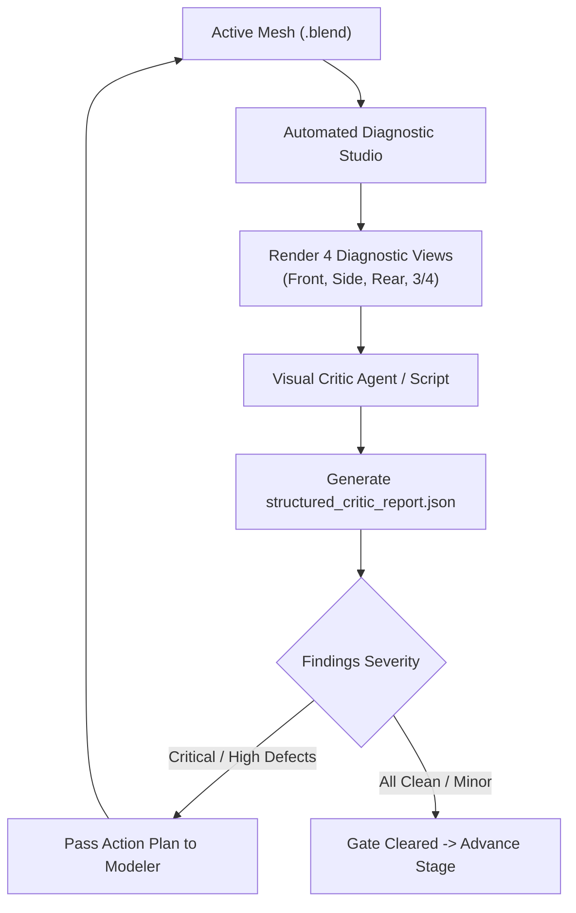

# [P0 · Issue 3] Screenshot-Based Diagnostic Visual QA & Structured Critic

## 1. Objective
Establish an automated visual feedback loop where Blender and Godot capture high-resolution diagnostic renders, and an AI visual critic analyzes them against reference specifications and outputs structured, machine-actionable findings.

---

## 2. The Feedback Architecture



---

## 3. Automated Diagnostic Camera Rig (Blender)
The diagnostic studio script (`scripts/tools/render_diagnostic_views.py`) sets up an automated turntable camera rig in Blender:
- **Environment**: Neutral 18% gray background (`#808080`), 3-point neutral daylight HDRI / key-fill setup with zero directional color tint.
- **Material**: Matte clay shader (Base color: 0.8 gray, Roughness: 0.5, Metallic: 0.0, zero specular highlights).
- **Camera Angles**:
  1. `render_front.png`: Orthographic/Long-telephoto (85mm) front view centered at pelvis/chest.
  2. `render_side.png`: True profile (90° lateral) showing spine curve, posture, and facial projection.
  3. `render_rear.png`: Back view showing trapezius slope, spine alignment, and lat width.
  4. `render_threequarter.png`: 45° dynamic perspective angle capturing depth and silhouette.
- **Output Directory**: Saved to `assets/creatures/<asset_id>/qa/diagnostic_views/`.

---

## 4. Structured Critic Schema
Vague feedback ("Make it look scarier") is prohibited. The critic must output valid JSON conforming to the following schema:

```json
{
  "$schema": "https://json-schema.org/draft/2020-12/schema",
  "asset_id": "sasquatch_classic",
  "stage": "base_anatomy",
  "evaluation_timestamp": "2026-11-08T20:30:00Z",
  "passed": false,
  "overall_summary": "Shoulder and chest proportions fail reference silhouette; cranium lacks sagittal slope.",
  "metrics": {
    "head_to_body_ratio": 0.12,
    "shoulder_to_height_ratio": 0.44,
    "arm_span_to_height_ratio": 1.15
  },
  "findings": [
    {
      "id": "ANAT-001",
      "category": "proportions",
      "severity": "critical",
      "target_component": "torso_and_shoulders",
      "issue": "Shoulder girdle is too narrow; neck appears defined rather than sloped into trapezius.",
      "action": "Broaden clavicles by 18% and raise trapezius muscle mass to eliminate visible neck collar."
    },
    {
      "id": "ANAT-002",
      "category": "cranium",
      "severity": "high",
      "target_component": "sagittal_crest",
      "issue": "Skull dome is spherical instead of conical slope seen in Patterson-Gimlin concept reference.",
      "action": "Sculpt backward slope from supraorbital brow upward to parietal peak."
    }
  ]
}
```

---

## 5. Implementation Tasks

- [ ] Author `scripts/tools/render_diagnostic_views.py` (Blender headless runner for 4-angle clay captures).
- [ ] Implement `scripts/tools/visual_critic.py` to parse diagnostic images, compare against `asset_spec.yaml`, and generate `qa/structured_critic_report.json`.
- [ ] Connect `visual_critic.py` with `scripts/tools/visual_qa.py` so graphics benchmarking audits both technical performance and visual critique.
- [ ] Create test suite that validates the diagnostic capture pipeline on `assets/creatures/sasquatch/`.

---

## 6. Acceptance Criteria
- [ ] Running `python3 scripts/tools/render_diagnostic_views.py --asset sasquatch` outputs all 4 diagnostic camera views to `assets/creatures/sasquatch/qa/diagnostic_views/`.
- [ ] `structured_critic_report.json` outputs structured findings with specific `target_component`, `severity`, and concrete `action` steps.
- [ ] Pipeline halts progression to fur/materials if any `critical` or `high` findings remain open.
