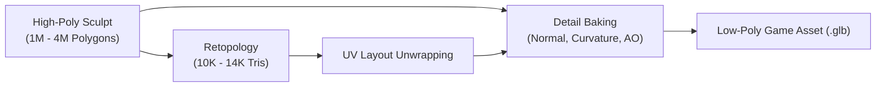

# [P1 · Issue 4] High-Quality Organic Sculpting and Retopology Pipeline

## 1. Objective
Establish a professional organic character sculpting, retopology, and map baking pipeline that transitions high-poly anatomical sculpts into clean, game-ready, animated meshes optimized for the GTX 960 hardware budget (8,000 – 16,000 triangles).

---

## 2. Anatomy Blockout & Sculpting Strategies
The pipeline supports three authoring paths depending on asset requirements:

1. **Digital Sculpting in Blender**:
   - Start from a unified organic base mesh (quad-based humanoid/simian blockout).
   - Use dynamic topology (Dyntopo) or Multiresolution modifier to sculpt primary anatomical masses (skull, ribcage, pelvis, limb cylinders).
   - Secondary anatomical pass: pectoral plates, clavicle, latissimus dorsi, biceps/brachialis, quadriceps, gastrocnemius, brow shelf, and flat simian muzzle.
2. **Image-to-3D Base Mesh Ingestion**:
   - Generate initial raw volume from concept art using state-of-the-art vision reconstruction tools.
   - Immediately bring into Blender for anatomical correction, symmetrization, and posture adjustments.
3. **High-Quality Base Mesh Adaptation**:
   - Leverage scanned or anatomically validated hominid base meshes, morphing proportions to match the Sasquatch spec.

---

## 3. Retopology & Topology Standards
The high-poly sculpt must be converted to an optimized game mesh:

- **Polycount Target**: 8,000 – 16,000 triangles total (quad-dominant).
- **Edge Loops & Deformations**:
  - 3-5 concentric edge loops around eyes and mouth.
  - Articulation loops at knees, elbows, shoulders, and hips to support bending without pinching or collapsing volume.
  - Continuous quad strips along the spine and ribcage.
- **UV Unwrapping**:
  - Non-overlapping UV layout with minimal distortion.
  - Seams placed along inner limbs, back of cranium, and underside of torso.
  - Texel density consistency across the mesh (higher density for head and hands).

---

## 4. Map Baking Pipeline
Bake high-detail information from high-poly sculpt to the retopologized mesh:
- **Tangent Space Normal Map (`nor_gl`)**:
  - 2048x2048 resolution.
  - OpenGL format (+Y Up).
  - Clean cage projection without ray misses or black seam artifacts.
- **Ambient Occlusion (AO)**:
  - Cavity darkening baked into channel for realistic grounding in Godot volumetric fog.
- **Curvature / Cavity Map**:
  - Used by shaders to modulate fur strand density and leathery skin wear.

---

## 5. Implementation Tasks

- [ ] Create automated retopology & decimation helper scripts for Blender (`scripts/tools/blender_retopology.py`).
- [ ] Implement cage baking automation for tangent normal and ambient occlusion maps (`scripts/tools/bake_character_maps.py`).
- [ ] Author test suite validating quad flow, manifold checks, and budget compliance for character exports.

---

## 6. Acceptance Criteria
- [ ] Exported game mesh is between 8,000 and 16,000 triangles.
- [ ] No non-manifold edges, loose vertices, or inverted face normals.
- [ ] Normal map correctly projects high-poly muscular definition onto the low-poly silhouette without baking seams.
- [ ] UV coverage occupies >75% of UV texture space with no overlapping islands.
