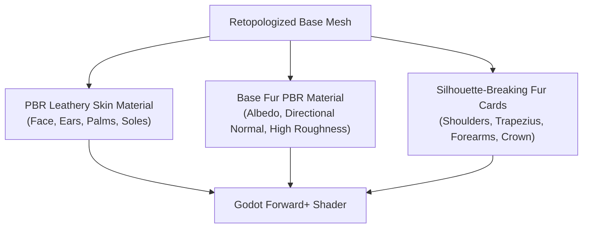

# [P1 · Issue 5] Fur, Materials, and Surface Detail Pipeline

## 1. Objective
Build a believable, physically plausible PBR fur and skin pipeline for the Sasquatch and future cryptids, utilizing groomed fur cards, directional flow maps, leathery dermis shading, and amber eye tapetum lucidum retro-reflection.

---

## 2. Fur Architecture: Cards + Shells + Shaders
Uniform procedural fur shaders look like static fuzz or carpet when viewed under dynamic lighting. A multi-tier approach is required:

### 2.1 Silhouette-Breaking Fur Cards
- Positioned along high-visibility silhouette edges:
  - Clustered across the trapezius slope and upper shoulders.
  - Hanging clumps on posterior forearms and calves.
  - Sagittal crest crown tufts.
- **Card Geometry**: Low-poly curved alpha quads (2-4 quads per clump) with vertex-color opacity fading at roots.
- **Alpha Mode**: Alpha Hash or high-quality Alpha Scissor with dithering to prevent sorting artifacts in Godot Forward+.

### 2.2 Directional Flow & Non-Uniform Distribution
- Fur follows natural gravitational and anatomical growth lines:
  - Crown: Directed backwards and downwards along cranium cone.
  - Torso: Flows downwards toward abdomen.
  - Arms: Flows toward wrists; elbows have outward whorls.
  - Back: Heavy cape layering down lumbar spine.
- Density masking prevents fur from covering the facial mask, palms, finger pads, and foot soles.

### 2.3 PBR Material Specs
- **Albedo Map**: Multi-tone dark chestnut brown with golden-auburn highlights; baked ambient cavity occlusion.
- **Normal Map (`nor_gl`)**: Fine micro-strand detail normal map blended with macro anatomical muscle normal.
- **Roughness Map**: 0.78 to 0.94 for fur (prevents synthetic plastic gloss under flashlight beams); 0.55 to 0.65 with subtle wet sheen for facial skin and snout.
- **Retro-Reflective Tapetum Lucidum**:
  - Eyes feature dark corneas with a concave amber tapetum reflector.
  - Subtle forward-facing emission or rim highlight activates when illuminated by the player's flashlight within a 45° angle.

---

## 3. Implementation Tasks

- [ ] Author high-resolution fur card atlas texture (512x1024 / 1024x1024) containing 8 clump variations (straight, clumped, ragged, tufted).
- [ ] Implement Blender geometry/curve script to groom and place fur cards along major muscle groups (`scripts/tools/generate_fur_cards.py`).
- [ ] Refine `assets/materials/sasquatch_fur.gdshader` to support tangent-aligned anisotropic strand highlights and soft depth fading.
- [ ] Create leathery dermis PBR material for face mask, hands, and feet with pore details and natural skin fold creases.

---

## 4. Acceptance Criteria
- [ ] Fur cards break up the smooth mechanical silhouette of the shoulders, arms, and head in profile and 3/4 views.
- [ ] No fur covers the palms, foot soles, lips, or orbital eye sockets.
- [ ] Material exhibits realistic matte scatter under direct flashlight illumination without specular blowout.
- [ ] Fur card draw calls and transparency comply with the GTX 960 fill-rate budget (no framerate dips).
