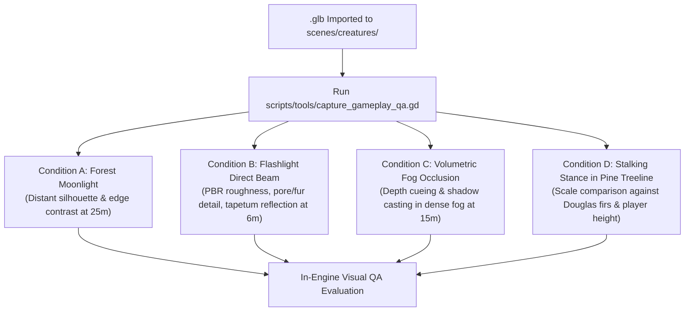

# [P1 · Issue 6] Godot Asset Integration and In-Engine Render Validation

## 1. Objective
Establish seamless coordination between Blender MCP and Godot MCP to import, assemble, rig, and visually validate game-ready assets inside Godot 4.7 Forward+ under live gameplay lighting, volumetric fog, and camera perspectives.

---

## 2. MCP Responsibility Contract

Neither tool may declare success prematurely:
- **Blender MCP**: Success is **not** declared when an OBJ or GLB exports. It succeeds when diagnostic renders match the visual specifications.
- **Godot MCP**: Success is **not** declared when a node instances into a `.tscn`. It succeeds when gameplay screenshots pass the four standard lighting test conditions.

| Responsibility Matrix | Blender MCP | Godot MCP |
|---|---|---|
| Open project & inspect geometry | ✅ High/low poly models | ✅ Scenes & resource trees |
| Sculpting & topology operations | ✅ Mesh tools & bakes | ❌ Not applicable |
| Export asset | ✅ Game-ready `.glb` (+Y up, -Z fwd) | ❌ Not applicable |
| Import & configure PBR materials | ❌ Only material templates | ✅ Forward+ Vulkan shaders |
| Collision hulls & physics setup | ❌ | ✅ Convex/compound collision |
| Animation tree & state machine | ✅ Rigging & keyframing | ✅ BlendTree integration |
| Render gameplay diagnostic captures | ❌ Diagnostic clay only | ✅ Live player camera views |

---

## 3. The Four Standard Gameplay In-Engine Test Conditions

Every hero creature asset merged into Godot must pass an automated capture sequence under four distinct environmental profiles:

1. **Condition A (Forest Moonlight)**:
   - Evaluates silhouette readability against distant illuminated fog at 25 meters.
   - Verifies the creature is instantly identifiable as a massive ape-like hominid rather than a human in a suit or a generic monster.
2. **Condition B (Flashlight Direct Beam)**:
   - Evaluates surface response at 6 meters under a 450-lumen spotlight.
   - Verifies that fur does not look glossy or blown out, skin looks leathery, and eyes retro-reflect amber light.
3. **Condition C (Volumetric Fog / Occlusion)**:
   - Evaluates atmospheric integration at 15 meters.
   - Verifies cavity ambient occlusion grounds the model in the mist rather than letting it glow unnaturally.
4. **Condition D (Stalking Treeline Scale)**:
   - Evaluates scale against mature Douglas fir trunks (2.85m creature height).
   - Verifies bent-knee center-of-gravity and arm reach proportion relative to the environment.

---

## 4. Implementation Tasks

- [ ] Create automated Godot headless capture script `scripts/tools/capture_gameplay_qa.gd`.
- [ ] Implement camera rig in `scenes/world/forest.tscn` to programmatically spawn the creature, set environmental conditions, and snapshot the 4 test profiles.
- [ ] Store screenshots in `assets/creatures/<asset_id>/qa/gameplay_captures/`.
- [ ] Connect gameplay capture checks to `scripts/tools/visual_qa.py`.

---

## 5. Acceptance Criteria
- [ ] Running `godot --headless -s scripts/tools/capture_gameplay_qa.gd` captures all 4 standard in-engine profiles to disk.
- [ ] The creature imports with zero missing texture bindings, zero missing bone weights, and intact collision hulls.
- [ ] Frame rate remains locked at 60 FPS on the GTX 960 reference profile during creature rendering.
