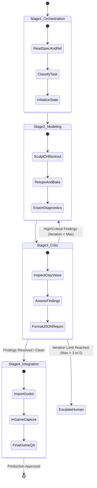

# [P2 · Issue 7] Automated Asset Orchestration and Iteration Safeguards

## 1. Objective
Design an efficient, single-agent sequential pipeline that moves assets through modeling, critique, and integration stages without spawning uncoordinated multi-agent teams or exhausting token budgets through unbounded iteration loops.

---

## 2. Sequential Stage Pipeline Architecture

Rather than running four autonomous agents simultaneously, a single Antigravity agent executes four sequential stages within a controlled state machine:

---

## 3. Iteration Caps & Threshold Policies

To prevent infinite loops and budget degradation:
1. **Hard Iteration Caps**:
   - **Hero Creatures (Sasquatch, Wendigo)**: Maximum **5 iterations**.
   - **Environment Props / Cabins**: Maximum **3 iterations**.
   - **Minor Props / Foliage**: Maximum **2 iterations**.
2. **Severity Escalation Thresholds**:
   - `critical`: Pipeline blocks immediately and re-enters the modeling stage with targeted remediation instructions.
   - `high`: Pipeline executes one targeted modeling pass; if still unresolved after 2 passes, escalates with diagnostic diffs.
   - `medium` / `low`: Logged as backlog polish tasks; does not block progression to Godot integration.
3. **Escalation to Human**:
   - If maximum iterations are reached without clearing `critical` findings, the system halts, outputs the current diagnostic screenshots, and presents the decision to the developer.

---

## 4. Implementation Tasks

- [ ] Implement asset pipeline state tracking file: `assets/creatures/<asset_id>/qa/pipeline_state.json`.
- [ ] Create orchestrator runner CLI: `python3 scripts/tools/asset_pipeline_runner.py --asset sasquatch --stage all`.
- [ ] Implement hard loop limiter and automated escalation alerts in the runner script.

---

## 5. Acceptance Criteria
- [ ] `asset_pipeline_runner.py` executes stages sequentially and logs progress to `pipeline_state.json`.
- [ ] The orchestrator strictly respects the configured `max_iterations` cap.
- [ ] No parallel runaway background agents are spawned during pipeline runs.
